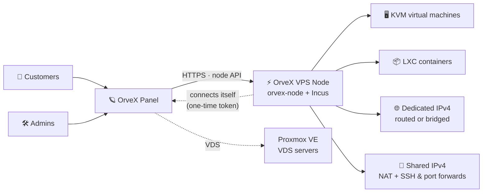

<div align="center">


<br />

[](../LICENSE)
[](#-install-in-one-command)
[](#%EF%B8%8F-vps-hosting-without-proxmox)
[](#-built-in-addons)
[](#-everything-included)

### Run your own hosting company from one panel.

Game servers, a complete billing suite, **VPS hosting with KVM + LXC on your own servers (no Proxmox required)** and **VDS on Proxmox VE**.<br />
Dedicated and shared IPv4, live stats, password changes, SSH details, snapshots and backups for every customer.

[**🚀 Install**](#-install-in-one-command) &nbsp;·&nbsp; [**🖥️ VPS hosting**](#%EF%B8%8F-vps-hosting-without-proxmox) &nbsp;·&nbsp; [**🧩 Features**](#-everything-included) &nbsp;·&nbsp; [**💳 Addons**](#-built-in-addons) &nbsp;·&nbsp; [**📖 Docs**](#-documentation)

</div>

---

## 🚀 Install in one command



```bash
curl -fsSL https://raw.githubusercontent.com/tanmay712/FeatherPanel/develop/install.sh | sudo bash
```

The interactive menu installs the panel, turns servers into VPS nodes, updates everything and shows the status. You can also go straight to a command:

| I want to… | Command |
| --- | --- |
| 🪐 Install the panel | `curl -fsSL https://raw.githubusercontent.com/tanmay712/FeatherPanel/develop/install.sh \| sudo bash -s -- panel` |
| 🔒 …on my domain with HTTPS | `curl -fsSL https://raw.githubusercontent.com/tanmay712/FeatherPanel/develop/install.sh \| sudo bash -s -- panel --domain panel.example.com` |
| ⚡ Add a VPS node | **Admin → Nodes (VPS) → Create**, then run the command the panel shows on the server |
| 🔄 Update | `orvex update` (panel) · `orvex node-update` (VPS node) |
| 📋 See what is running | `orvex status` |
| ❓ All options | `curl -fsSL https://raw.githubusercontent.com/tanmay712/FeatherPanel/develop/install.sh \| bash -s -- help` |

> [!TIP]
> **Requirements:** Debian 11–13 or Ubuntu 20.04–24.04 (amd64 or arm64) with root access.
> The **panel** wants 2 vCPU and 4 GB RAM. Building from source needs about 6 GB of RAM + swap, so the installer adds a swap file on smaller servers (or use `--images` once the GHCR images are published).
> A **VPS node** needs a dedicated server or a VPS with nested virtualization for KVM; LXC containers work everywhere.

After the panel install, open the printed URL and register: **the first account becomes the administrator.**

---

## 🖥️ VPS hosting without Proxmox

**OrveX VPS Node** is the panel's own node system. Create a node in the panel, run the one command it shows on
any Debian or Ubuntu server, and the node **connects itself**: templates, storage and the shared-IPv4 pool are
set up automatically. Nodes run [Incus](https://linuxcontainers.org/incus/) (KVM virtual machines **and** LXC
containers) behind a small agent, and customers manage them under **Virtual Servers (VPS)**.
Proxmox VE stays supported as its own product: **VPS** servers run on OrveX nodes, **VDS** servers on Proxmox VE
nodes (see [VDS and VPS](#vds-and-vps)). Game servers on Wings are not affected.



### What your customers get

<table>
<tr>
<td width="50%" valign="top">

📈 **Live stats**: CPU, memory, disk, network and disk I/O, with hour-to-year history graphs<br />
🔑 **Change password**: set a new root or user password from the panel, applied instantly<br />
🔐 **SSH details**: a ready-to-copy `ssh` command, also for shared-IPv4 servers<br />
🌐 **IP information**: dedicated or shared IPv4 and every forwarded port

</td>
<td width="50%" valign="top">

⚡ **Power controls**: start, stop and reboot<br />
🖼️ **Browser console**: VNC console for KVM servers<br />
💾 **Snapshots and backups**: create, roll back and restore<br />
♻️ **Reinstall**: a fresh operating system in a few clicks

</td>
</tr>
</table>

### VDS and VPS

Virtual servers come as two products, and the kind of node decides which one a server belongs to. Offer one,
the other or both: each has its own admin pages, customer pages, dashboard widget and switch under
**Admin → Settings → Modules**.

| | VDS: Proxmox VE node | ⚡ VPS: OrveX node |
| --- | :---: | :---: |
| Admin menu | Nodes (VDS) · Virtual Servers (VDS) | Nodes (VPS) · Virtual Servers (VPS) |
| Customer pages | `/dashboard/vms` · `/vds/{id}` | `/dashboard/vps` · `/vps/{id}` |
| Installation | ISO or Proxmox on Debian | **one command** on Debian/Ubuntu |
| Adding it to the panel | API token, templates and IP pool by hand | ✅ connects itself, templates and shared IPv4 included |
| KVM virtual machines | ✅ | ✅ |
| LXC containers | ✅ | ✅ |
| Dedicated IPv4 | ✅ bridge | ✅ routed or bridge |
| Shared IPv4 (NAT) | manual setup | ✅ automatic SSH + port ranges |
| Password change from the panel | KVM only (next boot or guest agent) | ✅ KVM + LXC, instantly |
| Browser console | ✅ | ✅ KVM |
| Stats, snapshots, backups, reinstall | ✅ | ✅ |
| Firewall rules, boot order, ISO library, live migration | ✅ | not yet |

### Shared IPv4, explained

Shared-IPv4 servers get a private address on the node (`10.77.0.N`). The node forwards an SSH port and a
block of 20 ports (TCP and UDP) on its public IP, and the panel shows them to the customer:

| Private IP | SSH | Your services (same port inside the server) |
| --- | --- | --- |
| `10.77.0.2` | `node-ip:22002` → port 22 | `node-ip:30040-30059` |
| `10.77.0.10` | `node-ip:22010` → port 22 | `node-ip:30200-30219` |
| `10.77.0.254` | `node-ip:22254` → port 22 | `node-ip:35080-35099` |

### Add a VPS node in two steps

1. **In the panel**: **Admin → Nodes (VPS) → Create**. A name and a location are all it needs.
2. **On the server**: run the command the panel shows, as root. It looks like this:

   ```bash
   curl -fsSL https://raw.githubusercontent.com/tanmay712/FeatherPanel/develop/install.sh | sudo bash -s -- vps-node --panel https://panel.example.com --token orvx_… -y
   ```

   It installs Incus, the storage pool, the shared-IPv4 bridge and the agent, then **connects the node to the panel**.
   The node page switches to *Connected* by itself, with the templates (Ubuntu, Debian, Rocky, Alma and Alpine,
   KVM and LXC) and the shared-IPv4 pool `10.77.0.2-10.77.0.254` already added.

Then create servers under **Admin → Virtual Servers (VPS) → Create**; customers find them under
**Virtual Servers (VPS)**. Add any extra public IPv4s of the node under **Node → IP Pool**, and turn on
**Admin → Settings → Proxy VNC via panel** for the browser console.

<details>
<summary><b>Install commands are single-use</b>, and other questions</summary>

<br />

- **The command expired or was already used?** Open the node → *Connect* → **New command**. Commands work once and expire after 24 hours.
- **Agent already installed** (or the server was reinstalled)? Run `orvex-node register --panel https://panel.example.com --token orvx_…` with a new command from the panel. *Re-pair node* does the same for a connected node.
- **The panel can't reach the node?** The panel connects to TCP port `8006` on the node. Open it in the server's firewall and at your provider, then press *Test connection*.
- **Want to install the node first?** Run `… | sudo bash -s -- vps-node` on its own and press Enter at the panel URL question. Later, create the node in the panel and run the `orvex-node register …` command from its *Connect* tab.
- **The node can't reach the panel?** Add it by hand under **Admin → Nodes (VDS) → Create** with the values from `orvex-node info`. The panel recognises the `orvex@orvex` user and lists the node under **Nodes (VPS)**; add the shared-IPv4 pool and templates there yourself.

</details>

<details>
<summary><b>Node command line</b> (<code>orvex-node</code>)</summary>

<br />

| Command | Does |
| --- | --- |
| `orvex-node register --panel URL --token T` | Connect the node to the panel (the panel shows this command) |
| `orvex-node info` | Show the panel connection, plus the values for adding the node by hand |
| `orvex-node status` | List guests with type, status, IP, network mode and SSH endpoint |
| `orvex-node templates` | List templates and which ones are downloaded |
| `orvex-node cache-templates [name...]` | Pre-download template images for fast deploys |
| `orvex-node doctor` | Check Incus, KVM, forwarding, storage, bridge, TLS and token |
| `orvex-node rotate-token` | Generate a new API secret (then re-pair the node from the panel) |
| `journalctl -u orvex-node -f` | Follow the agent log |

Configuration lives in `/etc/orvex-node/config.json` (templates in `templates.json`). Full details are in [`vps-node/README.md`](../vps-node/README.md).

</details>

---

## 🎁 Free servers

Give every user a small free server for their bot, app or database. Turn it on in **Admin → Free servers**, pick your Wings nodes and click **Install bundled spells**. Users then get a **Create server** button on their servers page and dashboard.

| Step | What users see |
| --- | --- |
| **01 What should it run?** | Runtimes: Node.js, Python, Bun, Java, C#, Rust and Lua. Databases: MongoDB, MariaDB, PostgreSQL and Redis. |
| **02 Name it** | A name (with a random-name button), an optional description and a summary card: 512 MB memory, 1 GB disk, 35% CPU, **Free**. |

- **Nothing gets deleted.** After 14 days without a login the server is stopped. After 30 days it moves to storage (suspended, with its files and port kept), and the owner gets it back with one click. Both limits can be changed, and the general inactive-server cleanup leaves free servers alone.
- **You set the limits:** resources, databases, backups, ports and servers per user. You also pick the nodes (the emptiest one with room goes first, and another node is tried if one fails) and the spell behind each stack.
- **Stacks can be changed later** from the server's **Settings**. Free servers can only switch to other free stacks.
- **Ads:** the create page can show an "ads pay for free servers" note. No ad network is built in: paste your ad code into the custom JavaScript setting (Admin → Settings → Other).

---

## 🧩 Everything included

<table>
<tr>
<td width="33%" valign="top">

### 🎮 Game servers
Wings nodes, file manager, console, schedules, databases, subusers and backups, plus optional **free servers** for your users. **12 bundled spells**: Minecraft (Vanilla, Forge, BungeeCord, Pumpkin), Rust, CS:GO, TF2, Insurgency, Source games, discord.py, Mumble and TeamSpeak 3.

</td>
<td width="33%" valign="top">

### 🖥️ VPS & VDS hosting
**VPS** on your own **OrveX nodes** (KVM + LXC, one-command setup) and **VDS** on Proxmox VE, each with its own menu and switch. Dedicated and shared IPv4, IP pools, templates, stats, password changes, console, snapshots, backups and reinstalls.

</td>
<td width="33%" valign="top">

### 💳 Billing
Credits, invoices, renewable plans, a resource store, AFK rewards, link rewards, redeem codes and referrals, all as **bundled addons**.

</td>
</tr>
<tr>
<td valign="top">

### 🌐 Web hosting
WebSpaces with domains, mailboxes and DNS automation on FeatherQuilld nodes.

</td>
<td valign="top">

### 🤖 AI assistant
A chat assistant for the panel and for VPS servers: status, power, backups and help.

</td>
<td valign="top">

### 🌍 19 languages
English plus 18 community translations, chosen in **Admin → Translations**.

</td>
</tr>
<tr>
<td valign="top">

### 🔌 Pterodactyl API
Pterodactyl-style application and client API for existing tooling and WHMCS modules.

</td>
<td valign="top">

### 🛡️ Security
2FA, passkeys, confirmation for sensitive actions, rate limits, activity and audit logs.

</td>
<td valign="top">

### 📊 Observability
Prometheus metrics, structured logs with Loki shipping, and ready-made Grafana dashboards.

</td>
</tr>
</table>

---

## 💳 Built-in addons

Every addon below ships in `backend/storage/addons/` and is active on the first start, with no marketplace installs needed.

| Addon | What it does |
| --- | --- |
| **Billing Core** (`billingcore`) | Core billing: user credits, invoices and admin billing management. Required by the other billing addons. |
| **Billing Plans** (`billingplans`) | Sell servers as renewable plans with credit-based billing (WHMCS-style subscriptions, renewals, suspensions). |
| **Billing Resources** (`billingresources`) | Gives users an account-level pool of resources (memory, CPU, disk) that they can split across multiple servers. |
| **Billing Resources: New Servers** (`billingresourcesnewservers`) | Lets users create servers from their purchased resources. |
| **Billing Resources: Store** (`billingresourcesstore`) | Lets users buy resources, or packages of resources, with credits. |
| **Billing AFK** (`billingafk`) | Rewards users with credits for staying on the AFK page. |
| **Billing Links** (`billinglinks`) | Users earn credits by visiting links (Linkvertise, LinkPays, GyaniLinks, ShareUS). |
| **Billing Redeem** (`billingredeem`) | Coupon codes that users redeem for credits. |
| **Billing Referrals** (`billingreferrals`) | Referral system that rewards users with credits for inviting new users. |
| **Pterodactyl Panel API** (`pterodactylpanelapi`) | Brings back a Pterodactyl-style API (application and client endpoints) for tools built against the Pterodactyl API. |
| **DiscordPlus** (`discordplus`) | Search users by Discord ID and optionally require Discord account linking. |
| **WidgetBot** (`widgetbot`) | Embeds your Discord server in the panel through WidgetBot. |
| **Minecraft Datapack Installer** (`minecraftdatapackinstaller`) | Install Vanilla Tweaks datapacks straight from the server page. |
| **CryptIO** (`cryptio`) | Wrapper to encrypt and decrypt strings in the MythicalPanel encryption format. |
| **DevUtils** (`devutils`) | Helper utilities for plugin developers. |
| **Let It Snow** (`letitsnow`) | Snowfall effect across the panel. |
| **Let's Celebrate** (`letscelebrate`) | New-year fireworks effect. |

Configure them under **Admin → Plugins**. Their database tables are created by the normal migrations (Docker runs them on every start).

<details>
<summary><b>Rebuilding addon frontends</b></summary>

<br />

The addon UIs are prebuilt into `Frontend/Components/<addon>/dist/`. After changing an addon's Vue source:

```bash
make addons            # or: scripts/build-addon-frontends.sh [addon ...]
```

</details>

---

## 🐳 Deployment options

<details>
<summary><b>Docker by hand, prebuilt images, upgrades</b></summary>

<br />

**Build on your server** (what the installer does):

```bash
git clone https://github.com/tanmay712/FeatherPanel.git /opt/orvexpanel && cd /opt/orvexpanel
docker compose -f docker-compose.v2.git.yml up -d --build
```

**Prebuilt images from GHCR**: the Docker workflows publish `ghcr.io/tanmay712/orvexpanel-*`, and `docker-compose.yml` uses them.

1. Enable workflows once under the repository's **Actions** tab (GitHub turns them off on forks).
2. Pushing to `develop` builds the `:dev` images; pushing a version tag such as `v1.0.0` builds `:latest`.
3. Make the packages public under GitHub → **Packages**, then run `install.sh panel --images` or `docker compose up -d`.

**Upgrading an existing install**: on startup the backend copies in bundled addons and translations that your volumes don't have yet. Each addon is seeded once, so uninstalled addons stay uninstalled and marketplace updates are kept. Volume, container and database names keep their `featherpanel_*` names, so existing installs upgrade in place.

</details>

---

## 📖 Documentation

<details>
<summary><b>Stack</b></summary>

<br />

| Layer | Technology | Path |
| --- | --- | --- |
| 🐘 Panel API | PHP 8.5 | `backend/` |
| ⚛️ Web UI | Next.js · React · TypeScript | `frontendv2/` |
| 🦀 Async jobs | Rust (`async-runner`) | `runner/` |
| ⚡ VPS node agent | Python 3 (stdlib only) on Incus | `vps-node/` |
| 📦 Installers | Bash | `install.sh`, `installer/` |

</details>

<details>
<summary><b>Developer docs, OpenAPI and plugin SDK</b></summary>

<br />

### 📚 Developer docs (icanhasfeatherpanel)

**icanhasfeatherpanel** is FeatherPanel’s static developer reference. No running panel is required to browse it.

<details open>
<summary><strong>What’s included</strong></summary>

<br />

| Section                  | Contents                                                                                             |
| ------------------------ | ---------------------------------------------------------------------------------------------------- |
| 🧩 **Plugins**           | Full Markdown guides for building addons (`conf.yml`, backend, frontend, SDK, packaging, AI recipes) |
| 🧭 **Pages**             | Every frontend Next.js route/slug (`pages/all.json`) for UI navigation guidance                      |
| 🧩 **Widgets**           | Injection points as HTML + `.md` + `.json`                                                           |
| ⌨️ **CLI**               | All `featherpanel` / `php cli` commands + production usage (`cli/usage.md`, `cli/all.json`)          |
| ⚙️ **Settings**          | Admin settings keys, types, options, categories from `SettingsController` (`settings/all.json`)      |
| 🧰 **Installer**         | `install.bash` flags, menus, automation env vars (`installer/guide.md`)                              |
| 🔐 **Permissions**       | Every permission node as HTML + `.md` + `.json` (`all.json`)                                         |
| 📡 **Events**            | Plugin hooks as HTML + `.md` + `.json` (`all.json`)                                                  |
| 🔌 **API reference**     | Redoc UI + raw `openapi.json`                                                                        |
| 🧠 **RAG index**         | `catalog.json` + `llms.txt` listing every machine-readable doc                                       |
| 🔑 **OAuth2 playground** | OAuth2 docs (live API calls still need a panel)                                                      |

</details>

<details>
<summary><strong>🌐 Live site (GitHub Pages)</strong></summary>

<br />

**https://mythicalltd.github.io/FeatherPanel/icanhasfeatherpanel/**

Plugin authoring (Markdown + AI index):

**https://mythicalltd.github.io/FeatherPanel/icanhasfeatherpanel/plugins/**

RAG / machine-readable index:

- **https://mythicalltd.github.io/FeatherPanel/icanhasfeatherpanel/rag/**
- **https://mythicalltd.github.io/FeatherPanel/catalog.json**
- **https://mythicalltd.github.io/FeatherPanel/llms.txt**

Examples for crawlers: `…/pages/all.json`, `…/cli/all.json`, `…/cli/usage.md`, `…/settings/all.json`, `…/installer/guide.md`, `…/permissions/all.json`, `…/events/all.json`, `…/widgets/index.json`, `…/api/openapi.json`, `…/plugins/ai-guide.md`.

</details>

<details>

<summary><strong>🛠️ Build locally</strong></summary>

<br />

Hand-authored inputs live in `frontendv2/icanhas/` (plugin Markdown, auth guides, assets, schemas). One command - `pnpm export:docs` - builds the **entire** `public/icanhasfeatherpanel/` tree (widgets, pages, permissions, events, API + OpenAPI, CLI, settings, installer, plugins/auth indexes, RAG). That output is gitignored and produced at ship time for **both** GitHub Pages (`pnpm build:public-docs`) and Docker/panel images (host `export:docs` then `frontendv2` image build, or `pnpm build:with-docs` / `make frontend`).

```bash
# 1. Generate OpenAPI from PHP controller annotations
cd backend
COMPOSER_ALLOW_SUPERUSER=1 composer openapi

# 2. Export docs + assemble static GitHub Pages site
cd ../frontendv2
pnpm install
pnpm build:public-docs

# Output lands in ../docs-site/
# Serve it with any static file server, e.g.:
python3 -m http.server 8080 --directory ../docs-site
```

For a normal panel image / local Next build that should include `/icanhasfeatherpanel/`:

```bash
cd frontendv2
pnpm build:with-docs   # export:docs then pnpm build
```

Optional environment variables for `build:public-docs`:

| Variable          | Purpose                                                                                |
| ----------------- | -------------------------------------------------------------------------------------- |
| `DOCS_OUTPUT_DIR` | Output directory (default: `docs-site/`)                                               |
| `DOCS_BASE_PATH`  | URL prefix for GitHub Pages project sites (CI sets `/FeatherPanel` from the repo name) |
| `OPENAPI_JSON`    | Path to the generated OpenAPI file                                                     |

</details>

---

</details>

<details>
<summary><b>CI and workflows</b></summary>

<br />

### 🔄 CI & workflows

<table>
<tr>
<th>Workflow</th>
<th>Purpose</th>
</tr>
<tr>
<td><a href="workflows/frontend.yml">frontend.yml</a></td>
<td>Builds the Next.js panel UI</td>
</tr>
<tr>
<td><a href="workflows/backend.yml">backend.yml</a></td>
<td>PHP lint, migrations, and backend tests</td>
</tr>
<tr>
<td><a href="workflows/runner.yml">runner.yml</a></td>
<td>Builds and tests the Rust async runner</td>
</tr>
<tr>
<td><a href="workflows/shell-lint.yml">shell-lint.yml</a></td>
<td>ShellCheck + syntax validation for the installer</td>
</tr>
<tr>
<td><a href="workflows/docs-pages.yml">docs-pages.yml</a></td>
<td>Generates icanhasfeatherpanel (not committed) + OpenAPI and deploys the static site to GitHub Pages</td>
</tr>
<tr>
<td><a href="workflows/docker-dev.yml">docker-dev.yml</a></td>
<td>Dev Docker images → GHCR (<code>develop</code>)</td>
</tr>
<tr>
<td><a href="workflows/docker-release.yml">docker-release.yml</a></td>
<td>Release Docker images on version tags</td>
</tr>
<tr>
<td><a href="workflows/docker-oci-release.yml">docker-oci-release.yml</a></td>
<td>OCI release artifacts</td>
</tr>
<tr>
<td><a href="workflows/codeql.yml">codeql.yml</a></td>
<td>Security analysis (JS/TS)</td>
</tr>
<tr>
<td><a href="workflows/dependency-review.yml">dependency-review.yml</a></td>
<td>Flags vulnerable dependency changes in PRs</td>
</tr>
</table>

</details>

<details>
<summary><b>Code statistics</b></summary>

<br />

<!-- COUNT-STATS:START -->

_Last updated: 2026-11-21T05:51:37.907Z_

| Extension | Files | Lines |
| --- | ---: | ---: |
| `.json` | 65 | 289,307 |
| `.php` | 979 | 227,665 |
| `.tsx` | 787 | 221,119 |
| `.ts` | 271 | 42,867 |
| `.yaml` | 5 | 7,825 |
| `.css` | 8 | 6,101 |
| `.rs` | 32 | 4,777 |
| `.sql` | 255 | 4,694 |
| `.yml` | 32 | 3,234 |
| **Total** | 2,434 | 807,589 |

<!-- COUNT-STATS:END -->

</details>

---

## 🤝 Contributing

Contributions are welcome. Please read the [contributing guide](CONTRIBUTING.md) and the [code of conduct](CODE_OF_CONDUCT.md) before opening a pull request.
Report OrveX-specific bugs on [GitHub Issues](https://github.com/tanmay712/FeatherPanel/issues).

## 📄 License

OrveX Panel is a modified version of [FeatherPanel](https://github.com/MythicalLTD/FeatherPanel) (Copyright © FeatherPanel Contributors / Mythical Systems) and, like the original, is licensed under the **[GNU Affero General Public License v3.0](../LICENSE)**. If you run a modified version for users over a network, the AGPL requires you to offer them its source code.

---

<div align="center">


<sub>OrveX Panel, built on FeatherPanel by <a href="https://mythical.systems"><strong>Mythical Systems</strong></a> and contributors.</sub>

<sub><a href="#-install-in-one-command">Install</a> · <a href="#%EF%B8%8F-vps-hosting-without-proxmox">VPS hosting</a> · <a href="https://github.com/tanmay712/FeatherPanel/issues">Issues</a> · <a href="https://github.com/tanmay712/FeatherPanel/releases">Releases</a> · <a href="https://docs.mythical.systems/docs">Upstream docs</a></sub>

</div>
